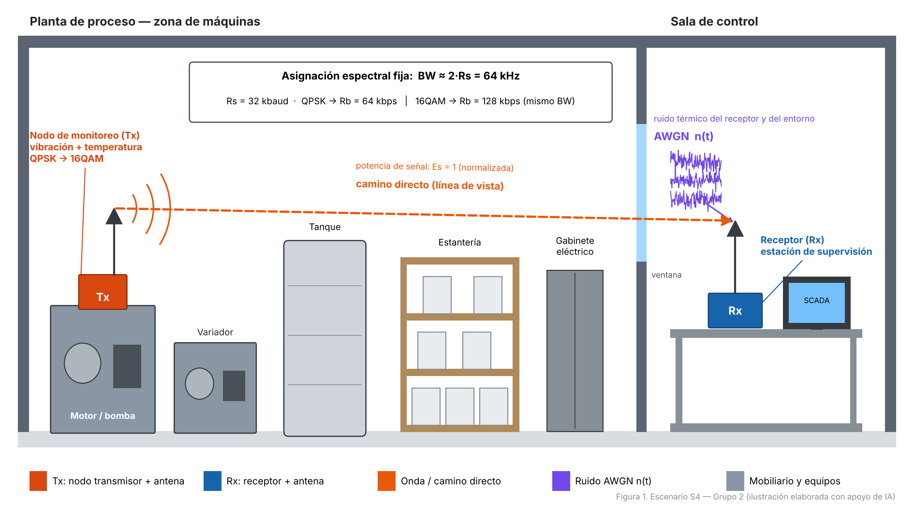
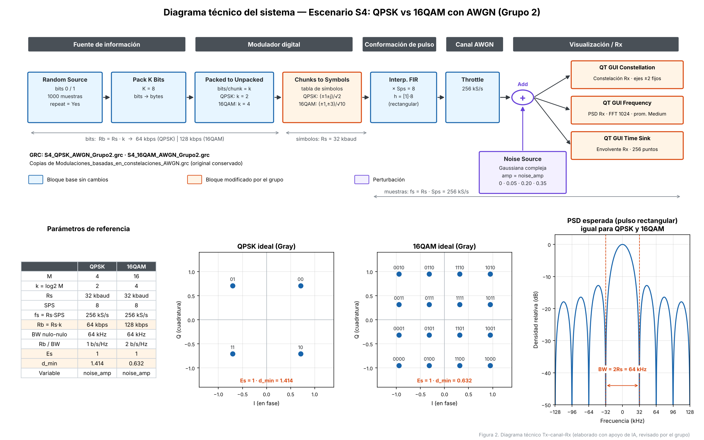

# Mayor tasa de datos con la misma tasa de símbolos: QPSK vs 16QAM con AWGN en GNU Radio

**Comunicaciones II (27145) · Proyecto Integrador 2026 · Grupo 2**

**Escenario:** S4 — Mayor tasa de datos con una tasa de símbolos similar

**Repositorio:** https://github.com/Juan1708-mx/ComunicacionesII_Grupo2
## Integrantes

- David Santiago Arias Avila
- Juan David Mantilla
- Nicolas Felipe Savedra

## Resumen

Este proyecto estudia el compromiso entre capacidad y robustez al aumentar la tasa de bits sin aumentar la tasa de símbolos. Se compararon QPSK (k = 2) y 16QAM (k = 4) en GNU Radio con la misma Rs = 32 kbaud, SPS = 8, fs = 256 kS/s y pulso rectangular; ambas constelaciones se normalizaron a potencia promedio unitaria. La única variable fue la amplitud del ruido AWGN (0; 0.05; 0.20 y 0.35). 16QAM duplica la tasa de bits (128 frente a 64 kbps) con el mismo ancho de banda entre nulos (64 kHz), como se verificó en la PSD. Sin embargo, su distancia mínima entre símbolos es 2.24 veces menor (≈ 7 dB): con SNR = 14 dB sus símbolos ya se superponen, mientras que QPSK sigue separable incluso con 9.1 dB. Una constelación más densa mejora la eficiencia espectral a costa de exigir mejor calidad de señal.



## Diseño técnico

| Parámetro | QPSK | 16QAM |
|---|---|---|
| M | 4 | 16 |
| Bits por símbolo, k = log2(M) | 2 | 4 |
| Tasa de símbolos, Rs | 32 kbaud | 32 kbaud |
| Muestras por símbolo, SPS | 8 | 8 |
| Tasa de muestreo, fs = Rs · SPS | 256 kS/s | 256 kS/s |
| Tasa de bits, Rb = Rs · k | 64 kbps | 128 kbps |
| Ancho de banda entre nulos (pulso rectangular), 2Rs | 64 kHz | 64 kHz |
| Eficiencia espectral, Rb / BW | 1 bit/s/Hz | 2 bit/s/Hz |
| Potencia promedio, Es | 1 | 1 |
| Distancia mínima, d_min | 1.414 | 0.632 |
| Perturbación | AWGN complejo | AWGN complejo |
| Variable del experimento | `noise_amp` | `noise_amp` |

Con Es = 1, la relación señal a ruido por muestra es SNR = 1 / noise_amp², es decir, SNR (dB) = −20·log10(noise_amp).



## Archivos GRC y cómo ejecutarlos

| Archivo | Descripción |
|---|---|
| `grc/archivos_modificados/S4_QPSK_AWGN_Grupo2.grc` | Sistema QPSK con AWGN (archivo principal) |
| `grc/archivos_modificados/S4_16QAM_AWGN_Grupo2.grc` | Sistema 16QAM con AWGN (archivo principal) |
| `grc/archivos_originales_o_referencia/` | Los cuatro GRC suministrados por el curso, sin modificar |

**Requisitos:** GNU Radio 3.10 (los archivos se crearon con GRC 3.10.12; en Windows se usó radioconda).

**Ejecución:**
1. Abrir el archivo `.grc` en GNU Radio Companion.
2. Presionar **F6** (Execute).
3. En la casilla *Amplitud de ruido AWGN*, escribir el valor de la prueba: 0, 0.05, 0.20 o 0.35.
4. Observar la constelación, la PSD y la envolvente compleja.

### Modificaciones respecto al GRC base

Ambos archivos son copias de `Modulaciones_basadas_en_constelaciones_AWGN.grc`. Los cambios fueron:

1. **`tabla_de_verdad_constelacion`:** se reemplazó la tabla OOK por defecto.
   - QPSK con mapeo Gray: `(1+1j)/√2, (−1+1j)/√2, (1−1j)/√2, (−1−1j)/√2`.
   - 16QAM con mapeo Gray: niveles {−3, −1, +1, +3} en I y Q, divididos por √10.
   - Las dos tablas tienen potencia promedio unitaria, para que el mismo `noise_amp` produzca el mismo SNR en ambas.
2. **QT GUI Constellation Sink:** `Autoscale = No`, con ejes fijos en ±2, para comparar todas las pruebas en la misma escala.
3. **QT GUI Time Sink:** `Number of Points = 256` (32 símbolos, 1 ms), para distinguir los niveles.
4. **QT GUI Frequency Sink:** promedio `Medium`, para obtener una PSD estable.
5. **Título e identificador** del flujograma.

No se cambiaron Rs, SPS, samp_rate, el pulso, la fuente de bits ni el bloque de ruido.

## Pruebas

| Prueba | Severidad | noise_amp | SNR | QPSK | 16QAM |
|---|---|---|---|---|---|
| A | Referencia | 0 | ∞ | 4 puntos ideales | 16 puntos ideales |
| B | Suave | 0.05 | 26.0 dB | 4 nubes pequeñas | 16 nubes separadas |
| C | Media | 0.20 | 14.0 dB | Nubes separadas | Las nubes se tocan |
| D | Fuerte | 0.35 | 9.1 dB | Todavía 4 grupos | La cuadrícula desaparece |

La tabla completa, con el análisis de cada prueba, está en [`data/tablas_de_pruebas/tabla_de_pruebas.md`](data/tablas_de_pruebas/tabla_de_pruebas.md) y en `pruebas.csv`. Las gráficas de cada prueba están en `figures/psd/`, `figures/constelacion_o_fsk/` y `figures/temporal/`. Las capturas completas están en `figures/capturas_originales/` (`_1` = envolvente y PSD; `_2` = PSD y constelación).

## Conclusión principal

Con la misma Rs, SPS, fs y nivel de ruido, 16QAM transporta el doble de bits que QPSK sin ocupar más ancho de banda, porque el espectro depende de Rs y de la forma del pulso, no de M. El costo es la robustez: con la misma potencia sus símbolos están 2.24 veces más cerca, por lo que se degrada en la prueba media (14 dB), mientras que QPSK conserva sus cuatro símbolos incluso en la prueba fuerte (9.1 dB). La PSD no muestra esta diferencia; la constelación sí. Se confirma la hipótesis H1 de la ficha de decisión técnica.

## Estructura del repositorio

```
ComunicacionesII_Grupo2/
├── README.md
├── grc/
│   ├── archivos_originales_o_referencia/   # 4 GRC del curso, sin cambios
│   └── archivos_modificados/               # GRC QPSK y 16QAM del grupo
├── figures/
│   ├── escenario/                          # Figura 1
│   ├── diagramas_tecnicos/                 # Figura 2 y capturas de los GRC
│   ├── psd/  constelacion_o_fsk/  temporal/   # 8 gráficas por tipo (A–D)
│   └── capturas_originales/                # 16 capturas de simulación
├── data/tablas_de_pruebas/                 # tabla y análisis de pruebas
├── docs/
│   ├── Informe_final.pdf
│   ├── ficha_decision_tecnica.pdf
│   └── bitacora.md
└── referencias/fuentes_y_enlaces.md
```

## Fase 2: transmisor con RRC y receptor

Flujogramas con conformación RRC (β = 0.35) y receptor diseñado por el grupo: filtro acoplado, diagrama de ojo, muestreo (Keep M in N) y decisión (Constellation Decoder). Sin ruido ambos sistemas recuperan el 100 % de los símbolos; con ruido, la SER medida coincide con la teórica.

| Prueba | noise_amp | SNR tras filtro acoplado | SER QPSK | SER 16QAM |
|---|---|---|---|---|
| A | 0 | ∞ | 0 | 0 |
| B | 0.35 | 18.1 dB | 0 | 5.0×10⁻⁴ |
| C | 0.70 | 12.1 dB | 1.0×10⁻⁴ | 0.103 |
| D | 1.00 | 9.0 dB | 4.7×10⁻³ | 0.282 |

Detalle en [`Fase2/README.md`](Fase2/README.md) e informe en [`Fase2/Informe_fase_2.pdf`](Fase2/Informe_fase_2.pdf).

## Uso de IA

Se usó Claude (Anthropic) como herramienta de apoyo para:

- Generar con código las imágenes del escenario (Figuras 1 y 2).
- Revisar la configuración de los GRC y verificar cálculos (normalización de las constelaciones y SNR).
- Apoyar la redacción y la organización de los documentos del repositorio.

La simulación, las pruebas y las capturas las realizó el grupo en GNU Radio. Todo el contenido fue revisado y validado por los integrantes.

## Referencias

Ver [`referencias/fuentes_y_enlaces.md`](referencias/fuentes_y_enlaces.md).

---
_Última actualización: 9 de noviembre de 2026_
